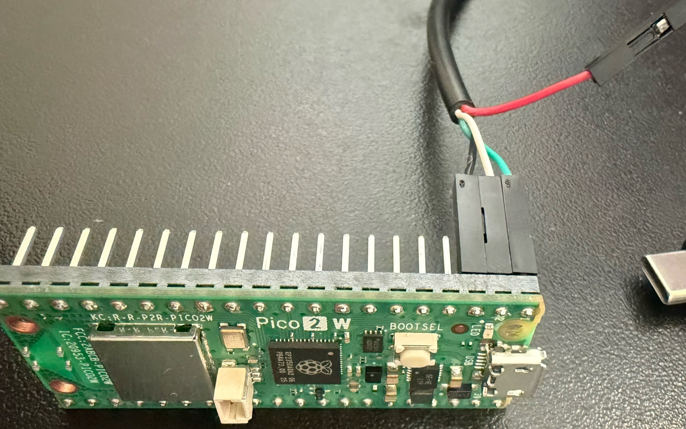

# 17 — Recovering an FM-1 to stock V15 with a Raspberry Pi Pico 2 W

How the owner's FM-1 was brought back from "no display, no USB" to stock V15
on 2026-10-26: a Pico 2 W running kurogedelic's
[FM-1-transporter](https://github.com/kurogedelic/FM-1-transporter) with the
RP2350 patch in [`tools/fm1-transporter/`](../tools/fm1-transporter/). The
run itself, with every hash and log line, is
[`notes/2026-10-26-fm1-stock-v15-recovery.md`](../notes/2026-10-26-fm1-stock-v15-recovery.md).
Confidence marks as elsewhere.

**Read this first.**

- **When this applies.** The procedure writes the FM-1's flash. It is for a
  unit that no longer boots, or one whose owner has decided to return it to
  stock. It is the project's approved recovery route for this unit (owner,
  2026-10-26). Writing anything Lunar builds still follows the staged policy
  in [docs/07 §4](07-recovery-and-risk.md#4-rules-of-engagement-owner-revised-2026-10-07).
- **Where the risk is.**
  - A write that stops part way (battery, cable) leaves the application
    region half written. The firmware refuses to write the boot area
    `0x0`–`0x4000`, so such a unit can be keyed again and rewritten (§6).
    The owner's unit got into that state once, from the interrupted install
    of 2026-10-15 [verified: recovery note].
  - A unit whose boot area is damaged is outside this guide; see docs/07.
- **Never with a running V15 attached:** `fm1t.py info`, `dump`, `write`
  and `uboot`, and the console `k`, put a running V15 into the mask ROM
  (owner decision D2; §8).
- **The wiring is push-pull with no series resistors,** as upstream designed
  it. docs/10 E1/E2 (open-drain, series resistors) rule that out for this
  project's own dongle. The owner made a standing exception for this route
  only (2026-10-26); E1/E2 still bind the project's dongle. On your own unit,
  take the same decision consciously.

## 1. What you need

| Item | Notes |
| --- | --- |
| Raspberry Pi Pico 2 W (a Pico 2 should do the same; untested) | GP0 and GP1 are the bus pins |
| A way onto the FM-1's USB-C D+/D−/GND | the owner used a USB-C plug to 4-pin 2.54 mm header lead: [XMSJSIY USB-C to 4 Pin Header Motherboard Adapter Cable, 30 cm, pack of 2](https://www.amazon.com/dp/B0G1358FPH). A USB-C breakout or a cut cable also works. **No VBUS**: the FM-1 runs on its battery |
| FM-1 battery charged | the write takes about a minute. A battery that dies mid-write leaves the app region half written; the boot area is untouched, so key it again (§4) and follow the failed-write advice in §6. Keep `dumpA.bin`; new dumps get new names |
| A Linux or macOS host with Python 3 and `pyserial` | the run used Linux (Raspberry Pi OS: `sudo apt install python3-serial`, and the user in the `dialout` group for the serial ports); `fm1t.py` finds the port by itself only on macOS |
| `wl82loader.bin` | JieLi's WL82 USB loader from kagaimiq's [jl-uboot-tool](https://github.com/kagaimiq/jl-uboot-tool) (MIT tool; the blob is JieLi's): 24,064 bytes, SHA-256 `d41da6126760c9d66660bcc0cac8d27d221806c5e369a8036921efe68dca5376`. It runs from the FM-1's RAM only. Never commit it |
| Stock V15 package `FM-1.fwsc` | from M-VAVE's CDN (docs/02 §1): 699,956 bytes, SHA-256 `db1642b2b6fa5c2cccb11ffd13878068bb28601678d3644049f99dc40e7edb8a`. Never commit it |
| Docker | to build the firmware (§2) |

The owner's run needed no 15 kΩ pull-downs with the patch [verified, one
unit, one run]. Upstream suggests them for the RP2350 (erratum E9); fit them
if the key misbehaves.

## 2. Build and flash the transporter

```bash
tools/fm1-transporter/build.sh            # -> scratch/fm1-transporter/fm1_transporter-pico2_w.uf2
```

The script clones upstream at the pinned commit `a7fb5e8`, applies the patch,
and builds with pico-sdk 2.2.0 in `ubuntu:24.04`. The UF2 flashed on
2026-10-26 had SHA-256
`4f5fab3ff5d3930ff1b462491bb2aa272e6536a7dfe3729e63839facd0b7f482`, and
`build.sh` rebuilt exactly that file on 2026-10-26 [verified]. The
`ubuntu:24.04` image and its packages are not pinned, so a later rebuild may
drift; if the hash differs, check the behaviour in §4 instead.

Hold BOOTSEL while plugging the Pico in, then copy the UF2 to the `RP2350`
drive. A Pico that already runs a pico-sdk USB serial firmware also enters
BOOTSEL when its port is opened at 1200 baud, and so does the transporter
(on its console port, interface 0, only).

The Pico then enumerates as `2e8a:000a` "FM-1 Transporter" with two CDC ports:

- **Interface 0** is the console (log, one-letter debug commands).
- **Interface 2** is the data port, which `fm1t.py` talks to.

On Linux, use `/dev/serial/by-id/usb-kurogedelic_FM-1_Transporter_<serial>-if00`
and `-if02`. The `ttyACM` numbers move every time the transporter reboots,
and `rekey` reboots it.

Also put the host tool and the shim in one directory:

```bash
mkdir -p ~/fm1t-run && cd ~/fm1t-run
curl -LO https://raw.githubusercontent.com/kurogedelic/FM-1-transporter/a7fb5e8ac692c528f8ed29e325911a3f4b8111d6/tools/fm1t.py
cp -r <lunar-checkout>/tools/fm1-transporter/research-shim .
# plus wl82loader.bin and FM-1.fwsc (check both SHA-256 values above)
export FM1_RESEARCH=$PWD/research-shim
```

Upstream's `fm1t.py write` imports a private `fm-1-research-lab` checkout to
vet packages. The shim stands in for it and is stricter: it accepts only the
stock V15 package above and refuses anything else
(`tools/fm1-transporter/UPSTREAM.md`).

## 3. Wire it

| Pico 2 W | FM-1 USB-C |
| --- | --- |
| GP0 | D+ |
| GP1 | D− |
| GND | GND |
| — | VBUS: **not connected** |



The owner's hookup is the USB-C to 4-pin header lead from §1
([B0G1358FPH](https://www.amazon.com/dp/B0G1358FPH)), its wires moved into
single-pin housings side by side, with the usual colours:

- **Green, D+:** to GP0, physical pin 1, the corner pin next to the Pico's
  own micro-USB.
- **White, D−:** to GP1, pin 2.
- **Black, GND:** to pin 3.
- **Red, VBUS:** in a housing of its own, connected to nothing.

Cables do not all follow the colour code. Check the D+ and D− lines with a
meter against a USB-C breakout before trusting the colours. The listing calls
that lead a power cable and does not say it carries data; on the owner's unit
its D+ and D− worked for the whole run [verified 2026-10-26].

D+ is the `USB_KEY` clock (CLAUDE.md trap 3). The transporter warns
"D- pulled up instead of D+" if the two are swapped, but only after the
ROM has acknowledged the key; with the lines swapped it may never get that
far (§4 step 3).

## 4. Enter mask-ROM UBOOT

1. **Switch the FM-1 off,** and check the switch itself: with no display you
   cannot tell whether it is on, and the owner's run started with it on by
   mistake.
2. **Open the console first, before you send anything.** On boot the
   transporter waits up to 10 s for the console before it starts keying.
   Output from before the console opens is buffered, but only about the last
   4 KiB, so open it early. A plain reader is enough; on Linux, for example:

   ```bash
   stty -F /dev/serial/by-id/...-if00 raw -echo 115200 && cat /dev/serial/by-id/...-if00
   ```

   `rekey` (step 3) reboots the transporter, which closes this port and
   ends `cat`. Run the same line again within 10 s of the `rekey`, or use a
   reader that reopens the port after a hangup.

   The console banner says `XIAO RP2040: D+=GP0/D6 D-=GP1/D7` on a Pico too;
   the pins are the same.
3. **Start the key.** Send `rekey` from the host tool. It prints "power-cycle
   the FM-1 now"; ignore that and leave the FM-1 off until the key runs:

   ```bash
   python3 fm1t.py --port /dev/serial/by-id/...-if02 rekey
   ```

   Reopen the console (step 2), then wait until it shows the key running
   steadily:

   ```text
   KEY: sending 0x16EF, polarity A (D+ clock, D- data). Switch the FM-1 ON now.
   KEY: 4090 packets
   KEY: 8180 packets
   ```

   If it says `D+ high in gap` within a few packets (then `PULSE`, and
   `HANDOFF` about 6 s later), the FM-1 is most likely on after all: switch
   it off and `rekey`. Otherwise the firmware is unpatched (§5) or the wiring
   is wrong; stop there. A patched build that catches a false pull-up logs
   `no ROM pull-up, false ACK` and `resuming key`, and carries on keying.

   If the key keeps running with no acknowledgement after the FM-1 is
   switched on, D+ and D− may be swapped or broken.
4. **Switch the FM-1 on.** The console shows `PULSE` at once, `HANDOFF` up to
   6 s later, and the ROM enumerating through the Pico's USB host about 2 s
   after that:

   ```text
   INQUIRY OK: vendor="WL82    " product="UBOOT1.00       " rev="1.00"
   UBOOT READY: enumerated and answered INQUIRY via the PIO host.
   ```

   `fm1t.py status` then reports `uboot=1`.

## 5. Why the patch: false handoffs on an RP2350

The bug, on unpatched upstream `a7fb5e8` on a Pico 2 W with the FM-1 off
[verified: bench log 2026-10-26]:

- The transporter reported `D+ high in gap (ACK missed?) after 28 packets`
  (about 14 ms).
- D+ read low 0.3 ms into the pulse phase and again at the 6 s timeout.
- After 6 s it handed off to its USB host anyway.

The key had stopped long before anyone could switch the FM-1 on.

The cause is a float [inferred]:

- The key program raised the clock and then released D+ (`set pindirs, 0`)
  in the same cycle that drove it low.
- On an RP2350 a released pad can hold a high level (erratum E9). An
  unpowered FM-1 charged by the clock can do the same.
- Either way, two samples read high and were taken for the ROM's 1.5 kΩ
  pull-up.

The patch does three things, and also resets D+ to its default drive
strength whenever the key starts:

1. **Fixes the float in PIO.** Both key programs drive D+ low for one cycle
   (`nop side 0`) before releasing it.
2. **Confirms a pull-up before acting on it.** D+ highs are counted with plain
   reads. The candidate is then confirmed once by driving D+ low for 1 µs and
   reading again 2 µs after release: a real pull-up recovers in that time, a
   stale level does not. That is one extra edge for the ROM, not one per
   sample.
3. **Gives the pulse phase a way back.** If D+ has been low for at least 1 s
   when the 6 s timeout comes, the transporter returns to keying instead of
   handing off.

A real ROM entry is left alone [verified: upstream's
`docs/logs/m0_success_2026-10-01.log`]:

- **The ROM's early D+ drop is untouched.** It drops D+ for a moment about
  7.3 ms after it pulls up. An earlier draft that rejected any 50 ms low
  would have risked that drop; review caught it.
- **So is its release and re-attach** about 4 s in, with a gap of about 1.1 s
  [reported: the comment in upstream `src/recovery.c`, from hardware on
  2026-10-01].

What is still untested:

- how long that 7.3 ms drop lasts;
- whether the ROM's calibration notices the one confirmation edge;
- an edge-free alternative: toggling the pad's input enable (the
  datasheet's E9 workaround).

## 6. Read, check, write, verify

All on the data port, with the loader (`--loader wl82loader.bin`). Every
step before `--write` is read-only.

```bash
P=/dev/serial/by-id/...-if02
python3 fm1t.py --port $P --loader wl82loader.bin info
#   OK key=980F type=3 id=856014      <- anything else: not an FM-1, stop
python3 fm1t.py --port $P --loader wl82loader.bin dump dumpA.bin
python3 fm1t.py --port $P --loader wl82loader.bin dump dumpB.bin --compare dumpA.bin
cmp dumpA.bin dumpB.bin                # must be identical; keep both
```

Before writing, check the dump:

- Its `0x0`–`0x4000` should equal the V15 image's: the type-0 entry, at file
  offset `0x414` of the package. If it does not, the SPL area is not what this
  procedure expects. Stop and read docs/07. To check (prints `True`):

  ```bash
  python3 -c "print(open('dumpA.bin','rb').read()[:0x4000]==open('FM-1.fwsc','rb').read()[0x414:0x4414])"
  ```

  `write` also refuses by itself if any sector below `0x4000` would change.
- On the owner's unit it also equalled the unit's earlier FM-1_092 backup
  [verified].

Then run the dry run, and show its output to whoever owns the unit:

```bash
python3 fm1t.py --port $P --loader wl82loader.bin write --package FM-1.fwsc --ref dumpA.bin
#   ... 143 sectors differ from --ref ...
#   package region equals --ref; device-data sectors changed since --ref: none
#   dry run: nothing written (add --write to write 143 sectors)
```

Only on the owner's go-ahead, write. Keep the FM-1 on and the wires still
until the final read is done:

```bash
python3 fm1t.py --port $P --loader wl82loader.bin write --package FM-1.fwsc --ref dumpA.bin --write
#   sector 0x04000: OK ... sector 0x92000: OK
#   final full read EQUALS the expected image
python3 fm1t.py --port $P --loader wl82loader.bin dump dumpC-after.bin   # independent check
```

What `write` does:

- It re-reads the whole flash and refuses to write unless the package region
  `[0, 0x93000)` equals `--ref`. Sectors above that (V15's settings) are
  reported if they changed, not refused.
- It writes only the sectors that differ, each erased, written and read back.
- It finishes with a full read.

The transporter refuses any sector outside `[0x4000, 0x93000)`.

If a sector write or the final read fails, do not power-cycle. Keep the FM-1
on and keep the output. Re-running against `dumpA.bin` will not work: the
flash no longer equals it, and `write` refuses. Take a fresh dump and write
against that instead (dry run first):

```bash
python3 fm1t.py --port $P --loader wl82loader.bin dump dumpD.bin
python3 fm1t.py --port $P --loader wl82loader.bin write --package FM-1.fwsc --ref dumpD.bin
```

If the unit has dropped out of UBOOT (the loader can reset), key it again
(§4); the boot area is never written.

## 7. Boot it and check the identity

1. Switch the FM-1 off.
2. **Disconnect the Pico.** A transporter that boots or is re-keyed while the
   FM-1 is off sends the key and puts it back in UBOOT; in host mode it can
   also soft-key a running V15 (`fm1t.py` or console `k`, §8). On the owner's
   run, a V15 left plugged into the Pico simply enumerated there.
3. Switch the FM-1 on. On the owner's unit it booted to stock V15 at once
   [reported: owner, 2026-10-26].
4. Plug the FM-1 into the computer with a cable that carries data. A
   charge-only cable shows nothing, and the FM-1 plugged into the Pico's
   breakout is not "on the computer". It should appear as `4c4a:c755` "FM-1".
5. Read its identity. This is read-only; on Linux use ALSA raw MIDI:

   ```bash
   tools/fm1_identify.sh            # sends only F0 00 32 45 00 00 00 40 7F F7
   ```

   It prints the reply as hex. To decode it, save the raw reply and pass it
   to the decoder (this is the path used on 2026-10-26):

   ```bash
   amidi -p hw:X,0,0 -S 'F0 00 32 45 00 00 00 40 7F F7' -r id.syx -t 3
   python3 tools/fm1_identify.py --decode-file id.syx
   ```

   It should say `identity: FM-1_015` with `checksum_ok: True` [verified
   2026-10-26: `fm1_identify.sh` on hardware for the first time, its reply
   decoded with `--decode-file`].

   On any OS, `python3 tools/fm1_identify.py --save id.syx` queries and
   decodes in one step (it needs mido and python-rtmidi); that path was not
   used on this run.

The sectors from `0x93000` up are V15's VM (settings) area, and the write
does not touch them. On the owner's unit they still held bytes from the
interrupted install. V15 booted anyway, presumably reformatting what it could
not use [inferred].

## 8. Things not to do

- **Do not run `fm1t.py info`/`dump`/`write`/`uboot`, or the console `k`
  command, while a working stock V15 is attached to the transporter.**
  - `info`/`dump`/`write` enter UBOOT by themselves when they see V15, and
    `uboot` does so on purpose.
  - `k` sends the soft key `F0 22 24 35 7D F7`.
  - Either way the FM-1 drops into the mask ROM (CLAUDE.md trap 9). That is
    only for a deliberate, authorised session.
- **Do not write any package but stock V15 with these files.** The shim
  refuses others on purpose.
- **Do not use `ramrun`, `selftest-write` or `runapp`** in this procedure.
- The procedure keeps to CLAUDE.md trap 11: the transporter never sends
  loader command `FC12` or the raw `0xA1` eFuse write, and the loader runs
  only in RAM [verified: upstream `src/jieli_uboot.c`].
- **Do not connect VBUS,** and do not leave the Pico wired to a working FM-1.
- **Do not commit** the loader, the package, the dumps or the UF2s. Keep them
  in `scratch/`.

## 9. Credits

- **kurogedelic:** FM-1-transporter (MIT); the key, pulse and host design
  and the write policy are theirs.
- **kagaimiq:** jl-uboot-tool, the `USB_KEY` documentation and the loader
  distribution.
- **czietz and FM-1 owners on aroum's issue #2:** the first reports of
  `USB_KEY` entry on FM-1s.
- **sekigon-gonnoc:** Pico-PIO-USB (MIT), the USB host the transporter uses.
- **AL-255:** the identity decoder.
- **JieLi:** the loader blob, used here under the terms it is distributed
  with.
