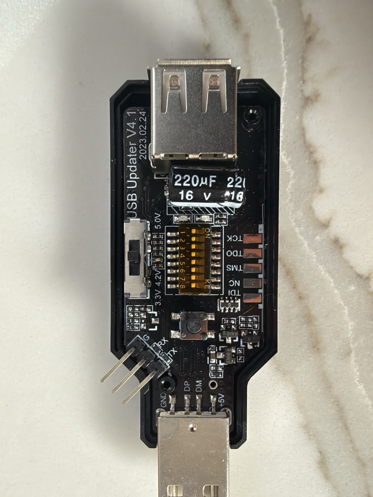
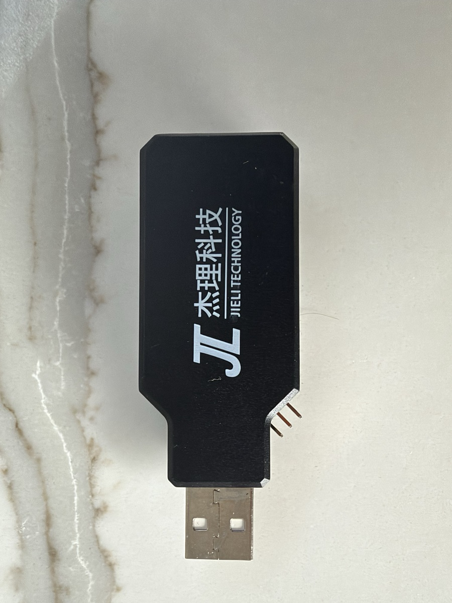
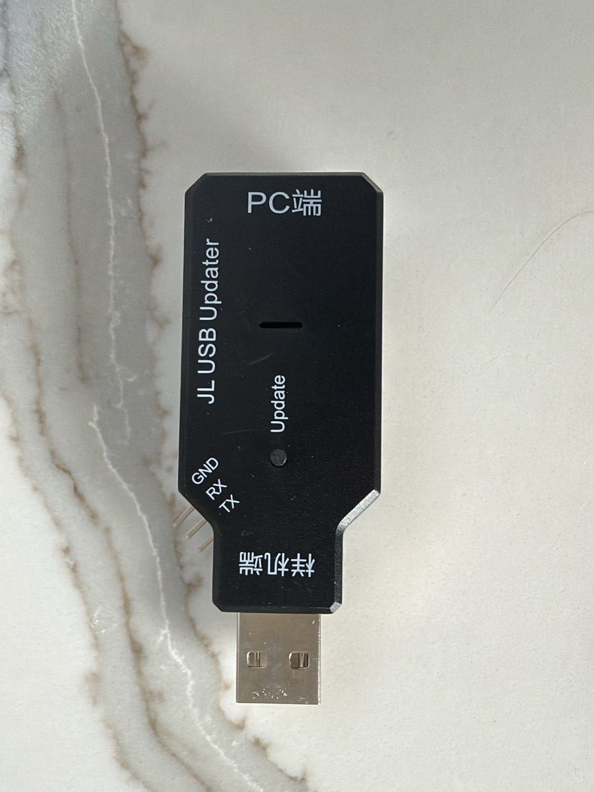

# 21 — JieLi's USB updater dongle on the FM-1

JieLi sells a "forced upgrade tool" (强制升级工具, "JL USB Updater"). It is the
vendor's own way to key a JieLi chip into its mask-ROM `UBOOT1.00` mode. One
arrived on 2026-11-10 and was tried on the owner's FM-1 the same day, under
four step-by-step owner approvals. **It did not get the FM-1 into the mask
ROM in any mode tried.** The project's recovery route stays the Pico 2 W with
FM-1-transporter (docs/17). The bench log is
`notes/2026-11-10-jl-usb-updater-arrival.md`.

## 1. The hardware

|  |  |  |
| --- | --- | --- |
| Board `USB Updater V4.1`, `2023.02.24` | Logo face | `PC端` / `样机端`, `Update`, `GND RX TX` |

Photos: the owner, 2026-11-10.

- **Ends** [verified: photo]:
  - `PC端` (PC end) is the USB-A **female** socket. It takes a cable from the
    PC.
  - `样机端` (target end) is the USB-A **male** plug, with pads `GND DP DM +5V`.
    The FM-1 needs a USB-A-female-to-USB-C-male adapter on it.
- **Controls** [verified: photo]:
  - an 8-way DIP switch;
  - an `Update` button;
  - a supply selector `5.0V / 4.2V / 3.3V` for the target's power.
- **Headers and pads** [verified: photo]:
  - a 3-pin `G RX TX` header;
  - pads `TCK TDO TMS NC TDI`.
- **LEDs** [verified: photo]: one red, one green. JieLi's manual describes
  them (below).

Read switch positions by asking, not from photos. In one photo, a shadow
made switch 3 look off when it was on.

## 2. What JieLi's manual says

Source: JieLi's manual for tool 4.0, SDK `doc/stuff/usb updater.pdf`
[verified: read 2026-11-10]. Summarised and translated here; this board is
V4.1.

**Low four switches** (one at a time):

| Switch | Mode |
| --- | --- |
| none | sends `usbkey` once per `Update` press, after cutting the target's power for ≥ 250 ms |
| 1 | cuts power periodically and keys each time |
| 2 | sends `ispkey`, for chips that need it |
| 3 | keys **continuously, no power cut**; the chip must be power-on reset (quick plug-in or wake-up) |
| 4 | reserved |

**High four switches:**

| Switch | Mode |
| --- | --- |
| 5 | DP/DM default to UART |
| 6 | SH50 flash mode |
| 7 | the tool has USB functions (virtual serial port, PC commands), from its next power-up |
| 8 | stay in upgrade mode |

**LEDs:**

| LEDs | Meaning |
| --- | --- |
| both flash once | tool powering up |
| red on, green flashing | idle |
| red on, green on | button pressed / keying |
| **red on, green off** | **target in upgrade mode** |
| both flashing | JTAG failure |

The manual's principle: the chip must restart from its boot code, and the
tool keys at that moment. The manual also says not to use hubs, docks or USB
3.0 ports.

**SPI flash access.** On a PC command, the tool can drive a SPI flash
directly through its JTAG pads:

| Pad | Tool line | Flash pin |
| --- | --- | --- |
| TMS | RX | CS |
| TCK | DP | CLK |
| TDO, TDI | DM | DO and DI |

This is no route for the FM-1, whose flash is inside the chip package
(docs/01).

## 3. What happened on the FM-1

The FM-1 was running stock V15. bench01 (Linux) watched only its kernel log,
and nothing was sent to the FM-1 or to the dongle.

| Try | Setup | Dongle LEDs | FM-1 | bench01 |
| --- | --- | --- | --- | --- |
| 1 | switches off, `Update` pressed once, port on the USB 3 controller | idle → red + green on | kept running V15, no reboot | one `usb3-port1: connect-debounce failed`, then nothing |
| 2 | same, FM-1 switched off and on | idle (window had ended) | booted V15 | nothing |
| 3 | switch 3 on, selector 5.0 V, dongle re-plugged, FM-1 switched off and on | red + green on (keying) | booted V15 | nothing |
| 4 | as 3, dongle on a USB 2-only port | red + green on (keying) | booted V15 | nothing |

[FM-1 and LEDs: reported, owner. bench01: verified, `dmesg -w` and `lsusb`.]

What this shows:

- **The power cut cannot reset a battery-powered FM-1** (try 1). The FM-1
  kept running on its battery while the dongle cut VBUS.
- **The dongle did not key the FM-1's ROM.** In tries 3 and 4 it was keying
  through the FM-1's power-up and never reached "green off".
- **The port was not the cause.** A USB 2-only port changed nothing.
- **When not keying successfully, the dongle passes nothing through.** With
  switch 7 off, the dongle never appeared on bench01. Neither did the running
  FM-1 behind it (`4c4a:c755`). So it cannot double as a pass-through cable.

## 4. Compared with the Pico 2 W route (docs/17)

| | JL USB updater V4.1 | Pico 2 W + FM-1-transporter (docs/17) |
| --- | --- | --- |
| Reached `UBOOT1.00` on this FM-1 | **no** (4 tries, 2026-11-10) | **yes** (2026-10-26) [verified] |
| VBUS to the FM-1 | **yes**, 5.0/4.2/3.3 V selectable | **none**: GND, D+, D− only; the FM-1 runs on its battery |
| Key | closed firmware; `usbkey` (the manual's term) | open; `0x16EF`, D+ clock (docs/10, trap 3), with a patched ACK check (docs/17 §5) |
| Key drive | unknown | push-pull, no series resistors (owner's D2 exception) |
| Feedback | two LEDs | console log of each key phase, the ROM's ACK and the SCSI `INQUIRY` |
| After keying | passes the ROM's USB to the PC (designed) | is itself the USB host: dumps and writes through its own commands |
| Host software | JieLi's Windows/Linux downloaders, which are **writers**: dev kit only | `fm1t.py` and our pinned `fm1t_m5.py`/`fm1t_m6.py` |
| Cost | US$8–18 | about US$7 plus a USB-C header lead |

Why the dongle fails here, as candidates, all [inferred]:

1. **VBUS.** The dongle powers the FM-1's USB-C VBUS. The Pico route never
   connects VBUS. With VBUS present, the FM-1's charger or power path may
   bring the chip up differently, or keep part of it powered while the slide
   switch is off. Then the slide switch would not give the ROM a clean
   power-on reset.
2. **Key timing or drive.** The dongle's key may not fall in the FM-1 ROM's
   window during a battery power-up. Its drive may also be too weak or too
   strong through the FM-1's USB-C path. docs/17 §5 shows how sensitive this
   is: the unpatched transporter mistook a floating D+ for the ROM's ACK.
3. **The key itself.** The dongle may send a different `usbkey` from the
   `0x16EF` the WL82 ROM accepts. The manual lists the WL83 family, not the
   WL82.

Not tried: switch 1 (periodic power cut) or switch 2 (`ispkey`), a
VBUS-free lead between dongle and FM-1, and the dev kit as a control. The dev
kit test would show whether the dongle keys a WL82 at all. The dev kit is
covered by the standing dev-kit authorisation. Each further FM-1 try needs
the owner's yes (docs/07 §4).

## 5. Use

- **Do not use JieLi's downloaders on the FM-1.** They are writers. Never
  pass `-key`, `-key1` or `-mkey`, and never send `0xFC12` or raw `0xA1`
  (trap 11).
- **For FM-1 recovery, use docs/17.**
